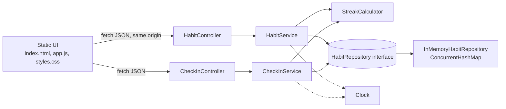

# Routine Stacker: Architecture

## Document Metadata

| Field | Value |
|---|---|
| Status | Ready for Review |
| Phase | 2 of 6: Architecture |
| Author | Architecture Agent (AI-drafted for user review) |
| Date | 2026-10-26 |
| Version | 0.2 |
| Upstream | `docs/requirements.md` v0.2, approved 2026-10-26T08:21:18Z |
| Repository | gurpreetchawla26/routine-stacker |

All architectural proposals from v0.1 are accepted in this version. The approval itself is recorded by the phase gate after review.

## 1. Context and Constraints

Routine Stacker is a single-user, in-memory habit tracker. The backend is Java 17 with Spring Boot 3.x. The frontend is static HTML, vanilla JavaScript, and CSS served by the same application. Persistence is an in-memory repository, so all data is lost on restart (NFR-009).

Fixed constraints (from the requirements):

- Spring Boot REST APIs with controller, service, and repository boundaries.
- Thread-safe in-memory storage, normally `ConcurrentHashMap`. No external database.
- Zero-build frontend. No React, Vue, Angular, or other heavy framework.
- No authentication, accounts, or external services.

## 2. Requirement Traceability

| Requirement | Components | Key decisions |
|---|---|---|
| REQ-001 Create habit | `HabitController`, `HabitService`, `HabitRepository` | Name uniqueness reserved atomically (D-4). Server-generated ID (D-3). |
| REQ-002 List habits | `HabitController`, `HabitService`, `HabitRepository` | Creation order from a sequence number (D-3). |
| REQ-003 Check in today | `CheckInController`, `CheckInService`, `HabitRepository` | Set-based check-ins, so one per date is atomic (D-5). Clock-based date (D-6). |
| REQ-004 Undo today | `CheckInController`, `CheckInService`, `HabitRepository` | Idempotent removal (D-5). Unknown habit returns 404 (OQ-A1). |
| REQ-005 History | `CheckInController`, `CheckInService` | Sorted newest first in the service. Unknown habit returns 404 (OQ-A1). |
| REQ-006 Streak | `StreakCalculator`, `HabitService` | Pure function over check-in dates and a `Clock` (D-7). Returned as `streak` (OQ-A2). |
| REQ-007 Responsive UI | `static/index.html`, `app.js`, `styles.css` | Same-origin fetch, no framework (D-9). `checkedInToday` drives Undo (OQ-A2). |
| NFR-001 Performance | All in-memory operations | O(1) lookups; list and streak work is linear in habits and check-ins. |
| NFR-002 Concurrency | `InMemoryHabitRepository` | `ConcurrentHashMap`, `putIfAbsent`, `ConcurrentHashMap.newKeySet()`, `AtomicLong`. |
| NFR-003 Validation | DTOs and `HabitService` | Validation before any repository write (section 5). |
| NFR-004 Error shape | `GlobalExceptionHandler` | One `ErrorResponse` record (section 5.4). |
| NFR-005 to NFR-007 Accessibility and usability | `static/` | Semantic markup, labeled controls, `aria-live` status (section 7). |
| NFR-008 Technology | Whole project | Java 17, Spring Boot 3.x, Maven, and vanilla static assets. |
| NFR-009 Durability | `InMemoryHabitRepository` | No persistence. Restart clears all data. Shown in the UI. |

## 3. Component Structure

### 3.1 Package layout

Root package `com.routinestacker` (accepted, OQ-A6):

```text
com.routinestacker
├── RoutineStackerApplication        Spring Boot entry point
├── config/ClockConfig              Clock bean (system default zone)
├── controller/HabitController      /api/habits
├── controller/CheckInController    /api/habits/{id}/check-ins
├── service/HabitService            habit rules, streak assembly
├── service/CheckInService          check-in rules and history
├── service/StreakCalculator        pure streak logic
├── domain/Habit, Frequency, CheckIn
├── dto/                            request and response records
├── repository/HabitRepository      interface
├── repository/InMemoryHabitRepository
└── web/GlobalExceptionHandler, ErrorResponse, *Exception
```

Static assets: `src/main/resources/static/index.html`, `app.js`, `styles.css`.

### 3.2 Responsibilities

- **Controllers** map HTTP to service calls, apply `@Valid`, and return status codes. They hold no business logic.
- **Services** validate and normalize input, enforce rules (uniqueness, one check-in per day), call the repository, and assemble responses with streaks.
- **StreakCalculator** is a pure component. It takes check-in dates, the frequency, and "today", and returns an integer. It has no state.
- **Repository interface** hides storage. Only `InMemoryHabitRepository` implements it now. A database could replace it later without touching services.

### 3.3 Component diagram



## 4. Repository and Concurrency Design

### 4.1 Storage

`InMemoryHabitRepository` holds three structures:

| Structure | Type | Purpose |
|---|---|---|
| `habits` | `ConcurrentHashMap<String, Habit>` | Habit by ID |
| `nameIndex` | `ConcurrentHashMap<String, String>` | Normalized name to habit ID (uniqueness) |
| `checkIns` | `ConcurrentHashMap<String, Set<LocalDate>>` with `ConcurrentHashMap.newKeySet()` values | Check-in dates per habit ID |

### 4.2 Decisions

- **D-3 Identity and order.** IDs are `UUID.randomUUID().toString()`. Each `Habit` carries a `long sequence` from an `AtomicLong`. The list is sorted by `sequence`, which gives creation order (REQ-002).
- **D-4 Atomic name uniqueness.** Name normalization is `trim().toLowerCase(Locale.ROOT)`. Creation first calls `nameIndex.putIfAbsent(normalized, id)`. If it returns a value, the service throws a conflict (409). Otherwise it stores the habit. This makes the 20-concurrent-create scenario in REQ-001 produce exactly one 201.
- **D-5 Atomic check-ins.** `Set.add(today)` returns `true` for a new check-in (201) and `false` for a duplicate (200). `Set.remove(today)` is idempotent (204 either way). No check-then-act race.
- **Object lifecycle.** Habits are never removed in this release (edit and delete are out of scope). Check-in sets are created when the habit is created. Stored objects are immutable value records, so readers never see partial updates.
- **Restart.** All state is discarded on shutdown. There is no snapshot or file IO (NFR-009).

### 4.3 Concurrency assumptions

- Each operation touches one habit's data, so per-operation atomicity from concurrent collections is sufficient. No multi-step transaction spans two maps.
- The one multi-map write, habit creation, reserves the name before writing the habit. A reader might briefly see a name reserved without its habit. A lookup by ID then returns 404, which is acceptable for a sub-second window. Creation is the only multi-map write, so no other operation can observe a half-built state.

## 5. Domain Model, API, and Validation

### 5.1 Entities

| Entity | Fields | Notes |
|---|---|---|
| `Habit` | `id` (String), `name`, `anchorRoutine`, `frequency` (`DAILY`/`WEEKLY`), `createdAt` (Instant), `sequence` (long) | `sequence` is internal and not serialized. |
| `CheckIn` | `habitId`, `date` (LocalDate) | Stored as a `LocalDate` in the habit's set. Only returned through history. |

### 5.2 Date and time semantics (A-2, OQ-2)

- "Today" is `LocalDate.now(clock)`, where `clock` is `Clock.systemDefaultZone()`.
- Dates serialize as ISO `yyyy-MM-dd`. `createdAt` serializes as ISO-8601 UTC instant.
- Weeks use ISO-8601 (Monday start) through `WeekFields.ISO` (OQ-3).
- Tests inject a fixed `Clock`. No test depends on the real date.

### 5.3 REST API

| Method | Path | Request | Success | Errors |
|---|---|---|---|---|
| POST | `/api/habits` | `{"name","anchorRoutine","frequency"}` | 201 with habit | 400 validation, 409 duplicate name |
| GET | `/api/habits` | none | 200 with array (oldest first) | none |
| GET | `/api/habits/{id}` | none | 200 with habit | 404 unknown habit |
| POST | `/api/habits/{id}/check-ins` | none | 201 new, 200 duplicate | 404 unknown habit |
| DELETE | `/api/habits/{id}/check-ins/today` | none | 204 | 404 unknown habit |
| GET | `/api/habits/{id}/check-ins` | none | 200 array of dates, newest first | 404 unknown habit |

Habit response shape (returned by every habit endpoint; accepted, OQ-A2):

```json
{
  "id": "3f2c9a4e-1b7d-4c1e-9a8f-0d2b6e5f7a10",
  "name": "Stretch",
  "anchorRoutine": "After coffee",
  "frequency": "DAILY",
  "createdAt": "2026-10-26T08:00:00Z",
  "streak": 3,
  "checkedInToday": true
}
```

Example: create request and response.

```http
POST /api/habits
Content-Type: application/json

{"name": "Stretch", "anchorRoutine": "After coffee", "frequency": "DAILY"}
```

```http
HTTP/1.1 201 Created
Location: /api/habits/3f2c9a4e-1b7d-4c1e-9a8f-0d2b6e5f7a10
```

`streak` and `checkedInToday` are included in every habit response. REQ-006 scenarios read `streak` from `GET /api/habits/{id}`, and the UI uses `checkedInToday` to decide whether to show Undo.

### 5.4 Validation and error contract

Validation (NFR-003), run before any repository write:

| Field | Rule | Error message example |
|---|---|---|
| `name` | Trimmed; required; 1 to 100 characters | `name: must not be blank` / `name: must be at most 100 characters` |
| `anchorRoutine` | Trimmed; required; 1 to 150 characters | `anchorRoutine: must not be blank` |
| `frequency` | Must be `DAILY` or `WEEKLY` | `frequency: must be one of DAILY, WEEKLY` |
| `name` (uniqueness) | Case-insensitive, trimmed | 409 `A habit named "Stretch" already exists` |

Error body (NFR-004), one shape for every 4xx and 5xx:

```json
{
  "timestamp": "2026-10-26T08:00:00Z",
  "status": 400,
  "error": "Bad Request",
  "message": "name: must not be blank",
  "path": "/api/habits"
}
```

Field-level messages are folded into `message` so the shape matches NFR-004 exactly. Stack traces are never included. Malformed JSON and unknown enum values are mapped to 400 by `GlobalExceptionHandler`.

## 6. Streak Logic (REQ-006)

`StreakCalculator` takes `(Set<LocalDate> dates, Frequency frequency, LocalDate today)`.

- **DAILY:** Start at `today` if it has a check-in, otherwise at `today - 1`. Count backward while dates exist. A habit with no check-in on the start day has a streak of 0.
- **WEEKLY:** Map each date to its ISO week (Monday start). Start at this week if present, otherwise last week. Count backward week by week.
- The function is pure, so every scenario in REQ-006 is a unit test with fixed dates.

## 7. Static Frontend

### 7.1 Structure

Files: `index.html` (semantic structure), `app.js` (fetch and DOM updates), `styles.css` (layout and states). No build step.

Page regions:

- `<header>` with the app name and a note that data resets on restart (NFR-009).
- `<main>` with a `<form>` to create a habit, and a `<section>` with the habit `<ul>` list.
- Each habit `<li>` shows name, anchor, frequency, streak, and a Check in or Undo button. A `<details>` element shows history on demand.

### 7.2 State and API access

- `app.js` calls `fetch` with relative URLs (same origin, no CORS).
- States per region: **loading** (busy indicator and `aria-busy="true"`), **empty** ("No habits yet. Add one above."), **error** (inline message in a `role="alert"` element), and **ready**.
- Buttons are disabled while their request is in flight, so double-submits are not sent.
- After any mutation, the app re-fetches the habit list. Local state is never trusted over the server.
- All server text is inserted with `textContent`, never `innerHTML`.

### 7.3 Responsiveness and accessibility

- Single-column layout under 600 px, and a wider list layout above it. No horizontal scroll at 360 px (NFR-006).
- Touch targets at least 44 × 44 px.
- Every input has a visible `<label>`. Buttons have text names that include the habit name (for example, "Check in Stretch").
- Visible `:focus-visible` outline. Text contrast at least 4.5:1 (NFR-005).
- Status and error messages live in an `aria-live="polite"` region.

## 8. Testing Boundaries

| Level | Scope | Tools |
|---|---|---|
| Unit | `StreakCalculator`, validation and normalization in services | JUnit 5 |
| Repository | Concurrency: 20 simultaneous creates with one name, 50 mixed operations (NFR-002) | JUnit 5 with an executor |
| API | Every endpoint and status code in section 5.3, plus error shape | Spring `MockMvc` |
| Browser | 360 px and 1920 px layouts, keyboard-only flow (REQ-007) | Manual check, or a headless browser |
| Restart | Data cleared after restart (NFR-009) | Manual check, or a context-restart test |

The `Clock` bean is replaced in tests with a fixed value.

## 9. Security and Operational Considerations

- No authentication (per requirements). The server binds to `localhost` only (accepted, OQ-A5), so only the local machine can reach it. Anyone with local access can still read and change data.
- XSS: server text is inserted only as `textContent`. No inline script.
- Input length limits (section 5.4) bound memory use per habit.
- Memory growth: check-in sets grow over time. At NFR-001 scale this is small. No eviction is planned.
- Error responses never include stack traces (NFR-004).
- Adding auth later would require CSRF protection for state-changing requests. This is noted as a future risk, not a current requirement.

## 10. Tradeoffs

| Choice | Benefit | Cost |
|---|---|---|
| Concurrent collections, not a global lock | Simple, scales to the expected load, no lock contention | Multi-map creation is not a single atomic transaction. Section 4.3 explains why this is acceptable. |
| Set-based check-ins | Atomic one-per-day rule without locking | Undo is limited to today by the API shape, which matches REQ-004. |
| Same-origin static UI | No CORS, no build step | Frontend and backend must ship together. |
| Streak computed on read | No stored streak to keep consistent | Linear cost per read. Fine at NFR-001 scale. |

## 11. Risks

| ID | Risk | Mitigation |
|---|---|---|
| R-A1 | Brief name reservation visible before the habit is stored (section 4.3). | Reserve-then-store order. Test that a failed lookup returns 404, not a partial object. |
| R-A2 | Streak edge cases around midnight and week boundaries. | Fixed-`Clock` unit tests, including day and week transitions. |
| R-A3 | Frontend and backend drift in field names. | Shared DTO names; API tests check the JSON shape. |

## 12. Open Questions (Resolved)

| ID | Question | Decision |
|---|---|---|
| OQ-A1 | Undo or check-in on an unknown habit: 404 or 204? | 404 for unknown habits on undo and history. Undo with no check-in today on a known habit is 204 (REQ-004). |
| OQ-A2 | Should `streak` and `checkedInToday` be in every habit response? | Yes. |
| OQ-A3 | Field-level validation text: inside `message` or a separate `errors` array? | Inside `message`, to match NFR-004 exactly. |
| OQ-A4 | Java, Spring Boot, and build tool. | Java 17, Spring Boot 3.x, Maven. |
| OQ-A5 | Bind address. | `localhost` only. |
| OQ-A6 | Root package name. | `com.routinestacker`. |

## 13. Decision Log

| ID | Decision | Status |
|---|---|---|
| D-1 | Spring Boot layered architecture (controller, service, repository). | Accepted |
| D-2 | Interface-backed in-memory repository (`ConcurrentHashMap`). | Accepted (fixed constraint) |
| D-3 | UUID IDs and an `AtomicLong` sequence for creation order. | Accepted |
| D-4 | Name uniqueness reserved with `putIfAbsent` on a normalized index. | Accepted |
| D-5 | Check-ins as concurrent sets; add and remove are atomic and idempotent. | Accepted |
| D-6 | "Today" from an injected `Clock` in the system default zone (OQ-2). | Accepted |
| D-7 | Streak computed on read by a pure `StreakCalculator` (ISO weeks, OQ-3). | Accepted |
| D-8 | `ErrorResponse` record with the NFR-004 shape; field errors folded into `message`. | Accepted (OQ-A3) |
| D-9 | Zero-build static frontend, same-origin fetch, `textContent` only. | Accepted |
| D-10 | Tech stack: Java 17, Spring Boot 3.x, Maven (OQ-A4). | Accepted |
| D-11 | Unknown habit returns 404 on undo and history (OQ-A1). | Accepted |
| D-12 | `streak` and `checkedInToday` in every habit response (OQ-A2). | Accepted |
| D-13 | Server binds to `localhost` only (OQ-A5). | Accepted |

## 14. Approvals

| Field | Value |
|---|---|
| Approved | No |
| Approved by | — |
| Approval date | — |
| Scope approved | — |
| Notes | Ready for review. Approval is recorded through `phase_gate.py review` after the user confirms it. Design Review has not started. |

> Approvals are recorded only after the user explicitly confirms them. Any change to the requirements after approval makes this architecture stale until reapproved.
